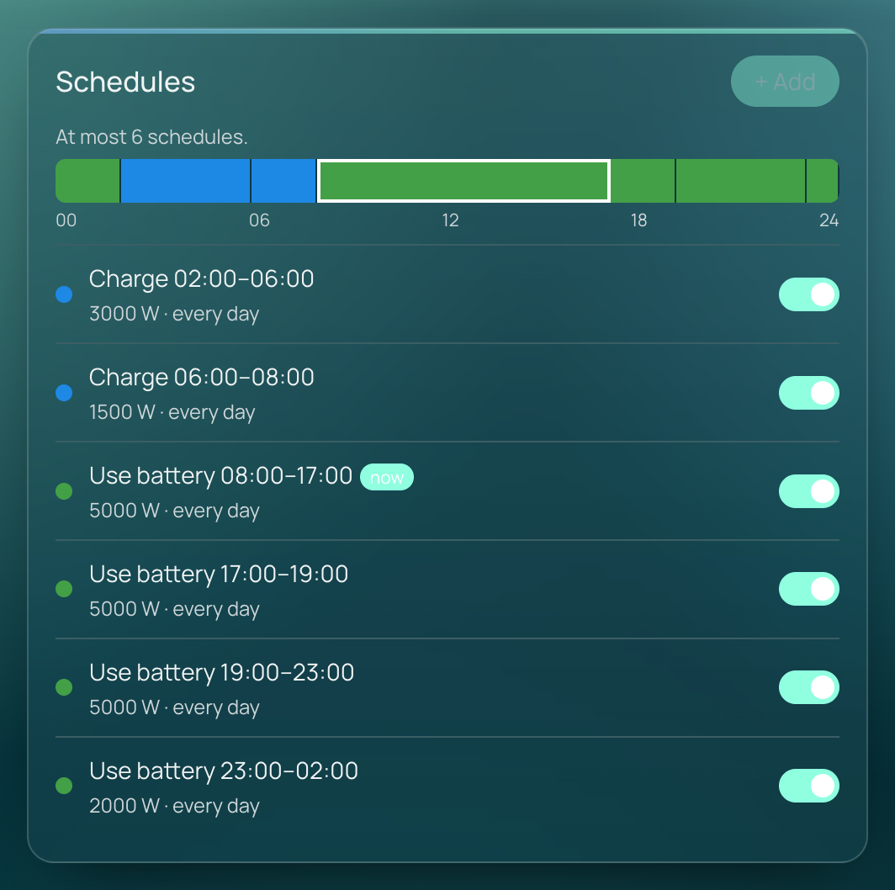

# EF PowerOcean Hybrid

EF PowerOcean Hybrid is a Home Assistant integration for EcoFlow PowerOcean
and Ocean 2 inverters: the PowerOcean Single Phase, Three Phase, Plus and DC
Fit, and the Ocean 2 Three Phase, Single Phase and Plus Single Phase. It reads the inverter over Modbus TCP on your local network and can
control its battery. For the PowerOcean Single Phase it can also use the EcoFlow
cloud, which adds the values Modbus does not have and lets you manage the
scheduled tasks of the EcoFlow app from Home Assistant.

## What it does

Over Modbus, the integration reads power, energy, battery, solar and grid values
every few seconds, without the cloud. With Modbus Control switched on, it can
charge, discharge or hold the battery, keep it between a charge limit and a
reserve, and follow commands from your automations.

With the EcoFlow cloud, a PowerOcean Single Phase also shows each battery pack
as its own device, with its state of health, cycles and temperatures. If the
inverter stops answering over Modbus, the cloud keeps the main values coming
until it answers again. Values that both sources report, such as house power or
the state of charge, are a single entity whose `source` attribute says where the
value came from.

With the cloud's MQTT connection switched on, you can change the app's backup
reserve and other settings, and add, change or delete the app's scheduled tasks.
The integration comes with a dashboard card for those schedules. While Modbus
Control is on, the battery can follow the same schedules through the
**Schedules** battery mode.

## Requirements

- Home Assistant 2026.9 or newer.
- For Modbus: Modbus TCP must be enabled on the inverter. It is off by default,
  and your EcoFlow installer turns it on in the EcoFlow Pro app.
- For the cloud: a PowerOcean Single Phase, the EcoFlow account it belongs to,
  and its serial number, which the EcoFlow app shows in the device's settings.

## Installation

With HACS:

1. In HACS, open the menu (three dots) and choose **Custom repositories**.
2. Add `https://github.com/abz2much/ef_powerocean_hybrid` with the type
   **Integration**.
3. Search for **EF PowerOcean Hybrid**, download it and restart Home Assistant.

Without HACS, download `ef_powerocean_hybrid.zip` from the latest release, unpack
it into `config/custom_components/ef_powerocean_hybrid` and restart Home
Assistant.

## Setting up

1. Go to **Settings > Devices & services > Add integration** and choose **EF
   PowerOcean Hybrid**.
2. Choose how Home Assistant reaches the system. With **Modbus TCP**, you enter
   the inverter's IP address and port (502 by default), then the model and a
   few limits. For a PowerOcean Single Phase, the next step lets you add the
   EcoFlow cloud by signing in. With **EcoFlow cloud only**, which is for the
   PowerOcean Single Phase, you sign in and enter the inverter's serial number.
3. To manage settings and schedules, open the integration's **Configure** page
   and turn on **Extended connection (MQTT)**. To add or change schedules, also
   set **Max schedule power**.

A PowerOcean Single Phase set up with Modbus alone can add the cloud later, and
one set up through the cloud alone can add a Modbus address later. Both are under
**Reconfigure** in the entry's menu.

## Documentation

- [Configuration](docs/configuration.md): every setup field and option, and what
  the MQTT connection adds.
- [Scheduled tasks](docs/schedules.md): the schedule switches, the actions and
  the dashboard card.
- [Battery control](docs/battery-control.md): Modbus Control, the battery
  modes, the guards, the Schedules mode and the safeguards.
- [Moving from another integration](docs/migration.md): from
  powerocean_single_phase or EF-PowerOcean-TcpModbus.
- [Troubleshooting](docs/troubleshooting.md).
- [Modbus register reference](EcoFlow_PowerOcean_Modbus.md).

## Credits

This integration is based on
[EF-PowerOcean-TcpModbus](https://github.com/MaxGrmm/EF-PowerOcean-TcpModbus) by
MaxGrmm. Its cloud and MQTT code comes from
[powerocean_single_phase](https://github.com/abz2much/powerocean_single_phase),
which is based on [powerocean](https://github.com/niltrip/powerocean) by niltrip.
All three are under the MIT licence. `NOTICE` lists the versions used, and
`EcoFlow_PowerOcean_Modbus.md` is MaxGrmm's register reference.

This project is not affiliated with EcoFlow. Controlling the battery writes to
the inverter; use it at your own risk.

## Licence

MIT. See `LICENSE`.
