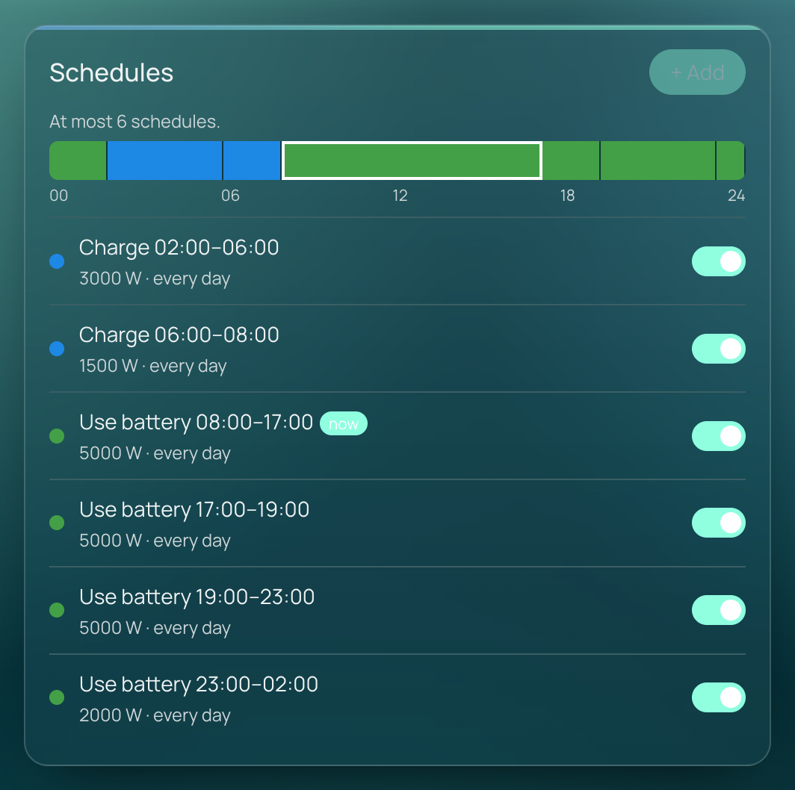
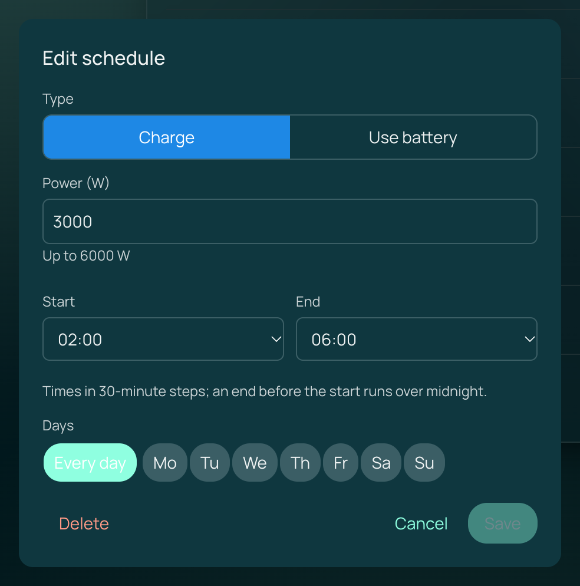

# Scheduled tasks

The EcoFlow app can run scheduled tasks on a PowerOcean Single Phase: at set
times, it charges the battery or uses it to power the house. The integration
shows these schedules in Home Assistant and can change them. It needs the
EcoFlow cloud and the option **Extended connection (MQTT)**. Adding or changing a
schedule also needs **Max schedule power (W)** in the options.

There is one list of schedules, the app's. A change made in Home Assistant shows
in the app, and a change made in the app shows in Home Assistant within a
minute.

## Entities

Each schedule is a switch named after what it does, for example "Charge
02:00-06:00 3000 W". Turning it off keeps the schedule but stops it running.
Its attributes hold the schedule's id, type, start, end, power and days, and
whether the inverter is running it now (`in_use`).

The **Active schedule** sensor shows the schedule that is running now, if any.

## The rules

The integration checks the same rules as the EcoFlow app before it sends
anything:

- There are at most 6 schedules.
- Schedules may not overlap, but one may start when another ends.
- Times are in steps of 30 minutes. A schedule may run over midnight, for
  example from 23:00 to 02:00.
- The power is a whole number of watts, from 1 up to Max schedule power.

Each change waits until the inverter's list shows it. If the system refuses a
change or does not confirm it, the action fails with the reason.

## Actions

`ef_powerocean_hybrid.add_schedule` adds a schedule. It targets the inverter's
device. Leave `days` out for a schedule that runs every day.

```yaml
action: ef_powerocean_hybrid.add_schedule
data:
  device_id: <the inverter device>
  type: charge # or use_battery
  power: 3000
  start: "02:00:00"
  end: "06:00:00"
  days: [mon, tue, wed, thu, fri]
  enabled: true
```

`ef_powerocean_hybrid.update_schedule` changes a schedule. It targets the
schedule's switch, and every field you leave out stays as it is. Use
`daily: true` to make a schedule run every day again; it cannot be combined with
`days`.

```yaml
action: ef_powerocean_hybrid.update_schedule
target:
  entity_id: switch.<device>_schedule_<id>
data:
  power: 2000
  end: "07:00:00"
```

`ef_powerocean_hybrid.delete_schedule` deletes the schedule of the switch it
targets.

## The schedule card

The integration includes a dashboard card for the schedules. Edit a dashboard,
choose **Add card** and pick **EF PowerOcean schedules**. If you have more than
one system, choose its Active schedule sensor in the card's editor.



The bar at the top shows today's schedules over 24 hours: Use battery in green
and Charge in blue, with the schedule in use outlined. Below it is every
schedule with its on and off switch. Schedules that do not run today are faded.

Tap a schedule to change or delete it, or tap **+ Add** for a new one. The form
checks the rules as you type and sends the whole schedule only when you press
**Save**. It then closes, and the card shows what is being sent. If the system
refuses the change, the card says why.



After updating the integration, reload the browser page, or clear the app's
cache, if the card still looks old.

## While Modbus Control is on

While Home Assistant controls the battery over Modbus, the inverter does not run
the app's schedules itself. The **Schedules** battery mode makes Home Assistant
follow them instead. See [Battery control](battery-control.md#schedules).
